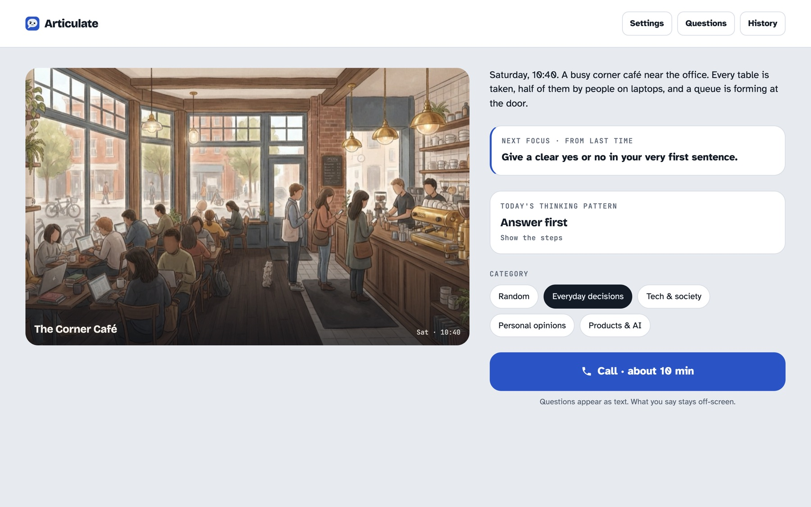
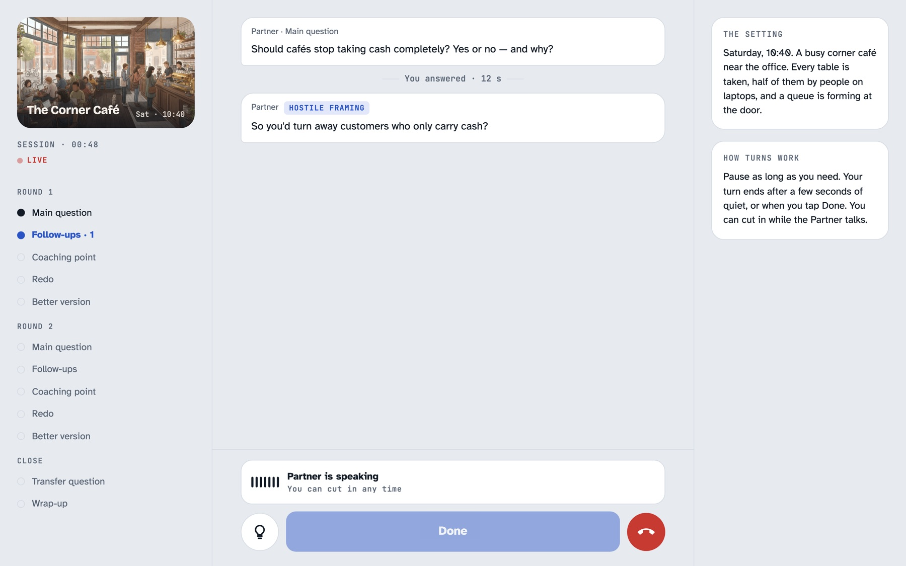
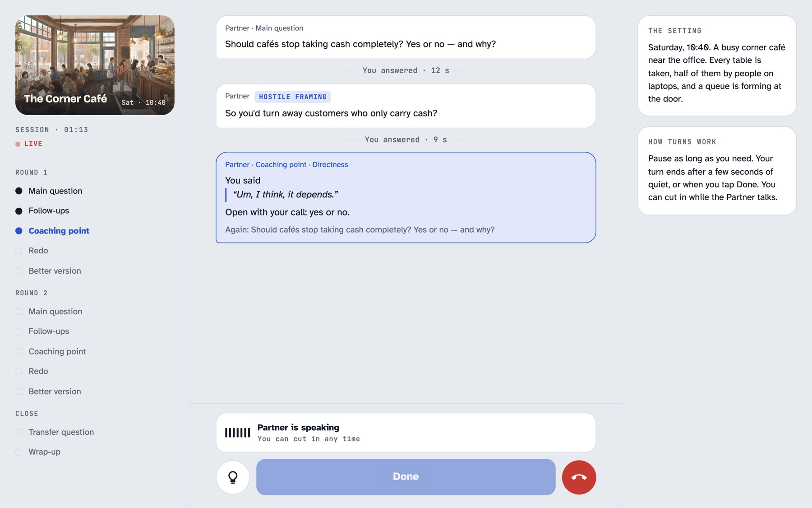
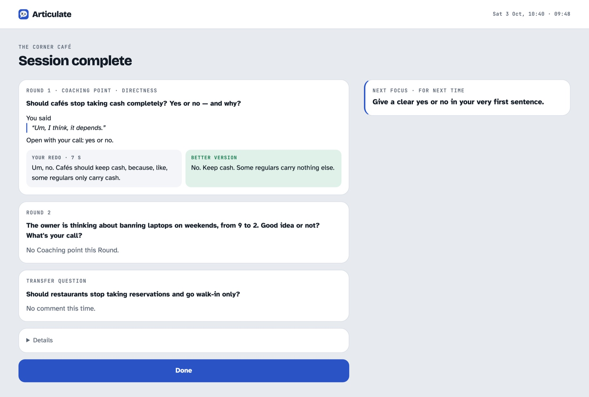

# Articulate

Practise answering hard questions out loud. Articulate is a ten-minute live voice call with an AI Partner that asks a question, pushes back on the answer, and gives one fix at a time.

[<!-- DEMO VIDEO: paste the GitHub upload URL for articulate-demo.mp4 on the line below, then delete this comment. -->](https://github.com/user-attachments/assets/6667d864-88b5-4576-b610-8e8f7e31fb15)



## Why

Being put on the spot in a meeting is its own skill. A senior person asks a question nobody prepared for, then follows up on the answer, and a few things tend to go wrong at once:

- The answer comes slowly, and slower still on the follow-up.
- "Um", "like" and "you know" fill the silence.
- The point arrives last, after the background, or never quite arrives.
- The answer is right but doesn't sound convincing.

Reading about structure doesn't fix this, because the hard part is doing it at speaking speed under pressure. Real meetings are a poor place to practise: the stakes are high, the chances are rare, and nobody says afterwards which sentence went wrong.

Articulate is a place to rehearse. The questions are unfamiliar, the follow-ups respond to what was actually said, the feedback quotes the speaker's own words, and the numbers show whether the practice is working.

## How a Session works

A Session is two Rounds and one Transfer question, about ten minutes in all.

1. **Main question.** The Partner sets a Scene (a café owner with a decision to make, for example) and asks for a call on it. Questions come from a bank of 216, and a question is never asked twice.
2. **Follow-ups.** The Partner presses two or three times, each time with a different kind of pressure: Why, So what, Counterexample, What would change your mind, Be specific, Have you considered…?, or Hostile framing.
3. **Coaching point.** The Partner names the single most important fix and quotes the words it applies to.
4. **Redo.** The speaker answers the same question again.
5. **Better version.** A rewrite of the speaker's own answer as Answer → Detail → So what, in short sentences, with no facts added.

After the second Round, a Transfer question checks whether the fix carries over to a question on a different subject.

| Follow-up | Coaching point |
|---|---|
|  |  |

During the call the speaker can pause to think without being cut off, end an answer early with Done, and ask for a silent Structure hint. Each Session practises one of three Thinking patterns (Answer first, First read, Two options + pick), and the speaker picks three Holding phrases to reach for when buying a second to think.

## What it measures

The summary shows the Redo next to the Better version, a Next focus for the following Session, and three numbers, each compared with the recent average:

- **Response latency**: the time from the end of the question to the first word of the answer.
- **Filler rate**: filler words per minute of speech, counted from a verbatim transcript.
- **Answer in the first sentence**: how often the answer opened with the call itself.



## How it is built

The call runs on the **Gemini Live API**. The browser streams microphone audio to Gemini over a WebSocket and plays the Partner's voice as it arrives. Three Gemini models share the work:

| Job | Model |
|---|---|
| The Partner's voice and the live conversation | `gemini-3.8-live` (Live API, native audio) |
| The Coach brain: Coaching point, Better version, Next focus | `gemini-3.8-flash` |
| Verbatim transcripts for the speech metrics | `gemini-3.5-transcribe` |

Two decisions shaped the design, and each has a short record:

- [The Partner speaks the Coaching point, but a text model chooses it](docs/adr/0001-partner-speaks-coach-brain-judges.md). Left to judge on its own, the Live model drifts toward agreeing and can't quote the speaker accurately. A separate model picks the point from the transcript, and the Partner says it, so the speaker still hears one voice.
- [The browser decides when a turn ends](docs/adr/0002-client-side-turn-taking.md). Gemini's automatic voice detection can't allow a three-second thinking pause and also end a turn the instant Done is tapped, so detection is off and the client signals the start and end of each turn from the microphone level.

The backend is a Cloudflare Worker. It serves the static client, checks a passcode (rate-limited by a Durable Object), mints short-lived tokens so the API key never reaches the browser, and runs the Coach brain. Session history stays in the browser's IndexedDB. The client is TypeScript with no framework.

More background:

- [CONTEXT.md](CONTEXT.md): the glossary. Session, Round, Follow-up, Coaching point and the other capitalised terms are defined there.
- [docs/spec.md](docs/spec.md): the product spec written before the build.
- [docs/research/gemini-stack-2026-10.md](docs/research/gemini-stack-2026-10.md): the model and cost research. A ten-minute Session costs roughly $0.30–0.36 in Live audio.
- [video/](video): the demo film's source. Every product frame is a capture of the real UI, driven by a harness that imports the app's own code.

## Running it

Articulate needs a [Gemini API key](https://aistudio.google.com/apikey), Node.js and a Cloudflare account for deployment. It targets Chrome on desktop and on iPhone.

```bash
cd app
npm install
```

Create `app/.dev.vars` with three values:

```
GEMINI_API_KEY=...
PASSCODE=...
SESSION_SECRET=...
```

```bash
npm run dev
```

`npm test` runs the unit tests and `npm run typecheck` the type checks. To deploy, set the same three values with `wrangler secret put`, then run `npm run deploy`.

## Status

Articulate is a personal project, published as a reference. It isn't a hosted service, and issues and pull requests are not monitored.

## Licence

[MIT](LICENSE). The fonts under `video/articulate-demo/assets/fonts/` are under the SIL Open Font License; see the [notice](video/articulate-demo/assets/fonts/NOTICE.md) there.
